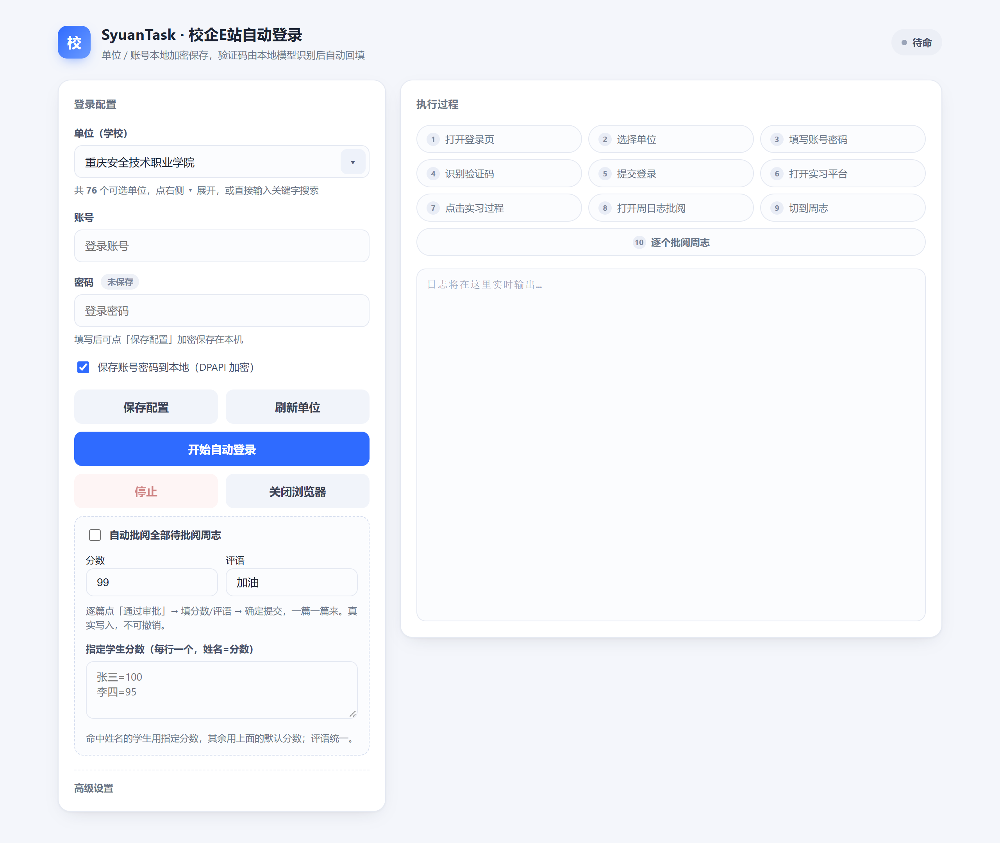

<div align="center">


# SyuanTask

> 校企E站自动登录助手 —— 算术验证码本地识别 + 十步浏览器自动化

本地网页控制台 + Playwright 浏览器自动化：**算术验证码本地识别** → 自动登录 → 一键进入实习平台 → 按规则逐个批阅学生周志。

[](https://www.python.org/)
[](#)
[](https://playwright.dev/)
[](LICENSE)

</div>



## 这是什么

很多学校的管理平台登录页带一道「一位数四则运算」的图形验证码，例如 `7-3=?`。每次登录都要自己看图算一遍，很碎。
SyuanTask 把这条链路完整自动化了：

- 账号、密码、单位存在**本机**，密码用 Windows DPAPI 加密，不联网、不上传
- 验证码交给本地训练好的 kNN 模型识别表达式并求值，失败自动换一张重试
- 登录后继续完成「实习平台 → 实习过程 → 周日志批阅 → 周志」的导航
- 可选：按统一分数与评语**逐篇串行**批阅待审周志，并支持给指定学生单独打分

全程由一个本地网页控制台驱动（`127.0.0.1:5178`），只监听本机回环地址，不对外暴露端口。

## 功能

| 能力 | 说明 |
| --- | --- |
| 🎯 验证码本地识别 | kNN 模板匹配 + 字符切分，识别 `a op b = ?` 并直接算出答案，不依赖任何打码平台 |
| 🔁 全链路重试 | 置信度过低自动换图（最多 3 张）；服务端报验证码错误自动重投（默认 6 轮）；账号密码错误立即停止，不盲目重试 |
| 🏫 单位全量下拉 | 76 个租户全部可选，支持关键字搜索、`▾` 展开、`↑↓` 键盘选择，默认值可配 |
| 🔐 密码本机加密 | Windows DPAPI（`CryptProtectData`），绑定当前 Windows 用户，换机器/换用户都解不开 |
| 🧭 十步自动化 | 登录 → 实习平台 → 实习过程 → 周日志批阅 → 周志 |
| ✅ 批量批阅（可选） | 逐篇串行，分数字/评语可配，每篇之间可设间隔；**以服务端「待批阅 N」减一作为成功判定** |
| 🎚️ 指定学生分数 | 一行一条 `姓名=分数`，命中者用特殊分数，其余走默认分 |
| 🖥️ 浏览器自适应 | 优先 Chrome，没有则用系统 Edge，再退 Playwright 内置内核；固定 1440×900 视口，不受窗口大小影响 |
| 📦 单文件 exe | `build.bat` 一键打包，104MB，目标机器不需要装 Python |

## 工作流程

| # | 步骤 | 关键实现 |
| --- | --- | --- |
| 1 | 打开登录页 | 等待 Vue 挂载完成 |
| 2 | 选择单位 | `el-select` 可搜索下拉：点击 → 过滤 → 点选项，并校验输入框回显 |
| 3 | 填写账号密码 | 按 `placeholder` 定位输入框 |
| 4 | 识别验证码 | 读取 `img.login-code-img` 的 `data:image` → 本地模型 → 求值 → 回填 |
| 5 | 提交登录 | 监听接口响应，区分「验证码错误」「账号密码错误」，前者换码重投 |
| 6 | 打开实习平台 | 点卡片 → 处理 `$modal.confirm` 确认弹窗 → 捕获 `window.open` 出的新标签页并切过去 |
| 7 | 点击实习过程 | 顶部横向菜单，**URL 不变**，以「侧边栏出现周日志批阅」为成功条件 |
| 8 | 打开周日志批阅 | 左侧纵向菜单，跳转 `/internship/process/log` |
| 9 | 切到周志 | 页面有两套同名控件，只点可见的 `el-button-group` 按钮，以内容区文本变化判定 |
| 10 | 逐个批阅（可选） | 读 `待批阅(N)` → 点学生 → 通过审批 → 填分数/评语 → 确定提交 → 等 `N-1` 才进入下一篇 |

## 快速开始

### 方式一：直接跑 exe（目标机器无需 Python）

1. 下载 `SyuanTask.exe`
2. 放到一个**可写**目录（配置会存在 exe 同目录的 `config.json`）
3. 双击，等 5～10 秒，浏览器自动打开控制台

> 单文件 exe 首次启动需要解包，慢是正常的；没有代码签名，SmartScreen 会提示「未知发布者」，选「更多信息 → 仍要运行」。

### 方式二：源码运行

```bash
git clone https://github.com/SumSafe/SyuanTask.git
cd SyuanTask
pip install -r requirements.txt
python src/app.py
```

Windows 下也可以直接双击 `启动.bat`，它会自动检查并安装依赖。

然后：

1. **单位**：输入关键字筛选，或点右侧 `▾` 展开全部 76 所（默认已选重庆安全技术职业学院）
2. **账号 / 密码**：填好点「保存配置」。密码用 DPAPI 加密后写入 `src/config.json`
3. 点「开始自动登录」，会弹出一个 Chrome/Edge 窗口执行步骤 1～9，界面右侧实时显示进度、验证码图片、识别结果和完整日志

登录成功后浏览器**保持打开**，可以直接接手操作；失败也保留现场，方便看报错。

### 方式三：自己打包 exe

```bash
# Windows
build.bat
# 或手动
pyinstaller --onefile --console --name SyuanTask ^
  --add-data "src/templates;templates" --add-data "src/pyapp;pyapp" ^
  --add-data "src/units.json;." --add-data "assets;assets" ^
  --icon "assets/logo.ico" --collect-all playwright ^
  --hidden-import pyapp.captcha --paths src src/app.py
```

三个不能省的参数，原因见 [实现细节](#打包为什么容易出错)。

## 配置项

界面「高级设置」里可改，也会写进 `config.json`。参考 `config.example.json`。

| 键 | 默认 | 说明 |
| --- | --- | --- |
| `url` | `https://syuantech.cn/login_1?redirect=%2FcontrolBoard%7D` | 登录页地址 |
| `max_attempts` | `6` | 验证码错误时的最大重投轮数 |
| `min_confidence` | `0.35` | 识别置信度低于此值就换一张验证码 |
| `slow_mo` | `120` | Playwright 每步操作间隔（毫秒），演示用 |
| `headless` | `false` | 是否无头运行（调试时建议 false） |
| `intern_text` | `实习平台` | 登录后要点击的入口文字，换模块只改这里 |
| `approve_enabled` | `false` | 是否执行第 10 步批量批阅（默认关闭，需手动勾选） |
| `approve_score` | `99` | 默认分数 |
| `approve_comment` | `加油` | 统一评语 |
| `approve_delay` | `800` | 每篇之间的间隔（毫秒） |
| `approve_limit` | `200` | 单次最多批阅篇数，防止误伤 |
| `score_overrides` | 空 | 指定学生分数，一行一条 `姓名=分数` |
| `browser` | `auto` | `auto` / `chrome` / `msedge` |
| `viewport_w` / `viewport_h` | `1440` / `900` | 页面视口，与窗口大小解耦（下限 1024×680） |

`score_overrides` 示例：

```text
张三=100
李四=95        # 井号开头是注释
```

分隔符支持 `= ： : , ，` 和空格；匹配时先精确比对，再退回「包含」匹配（能命中「张三（组长）」这类带后缀的名字）。

## 实现细节

### 验证码识别

`src/pyapp/captcha` 是一个纯本地的 kNN 识别器：灰度化 → 二值化去噪 → 切分字符 → 与 `data/arithmetic.npz`
里的模板做相关性匹配 → 得到形如 `7-3=?` 的字符串 → 用 `solver.py` 解析并求值。

站点返回的是 `data:image/...;base64`，所以不需要额外请求图片，直接 `base64.b64decode` 后送进模型。

### 「实习平台」不是点一下就开新标签页

扒前端代码（`chunk-*.js` 的 `handleJump`）后确认的真实顺序：

1. 点卡片 `.routeList` → 弹 `$modal.confirm`：「确定要跳转到模块：【实习平台】…吗？」
2. 点「确定」后写 `localStorage`（模块 id / 名称 / logo）
3. 才 `window.open(origin + "/workbench", "_blank")`

所以脚本必须：等确认框 → 点确定 → `context.expect_page()` 捕获新标签 → `bring_to_front()` → 等新页面渲染出内容。

⚠️ Element UI 的 MessageBox 是 `position: fixed`，用 `offsetParent` 判断可见性会误判为「隐藏」，
必须用 Playwright 的 `:visible` 伪类 —— 这个坑踩了很久。

### 两套「日志 / 周志 / 月志」

页面里同时存在：

- 隐藏的 `el-tabs__item`：点它必然 30 秒超时 `element is not visible`
- 可见的 `el-button-group` 按钮：真正能点的那套

脚本优先点 `button`，失败才退回 tab；切换完成以「内容区文本变化」判定，再用正则抓 `待批阅(N)`。

### 批阅为什么要串行

批阅是**不可撤销的写操作**。并发点击会导致：弹窗抢焦点、分数填到别人身上、`待批阅` 计数错乱。

因此每一篇严格走完「打开 → 填 → 提交 → 等计数减一」才进入下一轮，任何一篇失败立即停手，
不跳过、不强推。判定成功用的是服务端返回的状态（`待批阅(N)` → `N-1`），而不是「点了一下没报错」。

### 窗口大小 / 没全屏

早期用 `no_viewport=True`，页面跟着用户窗口走，于是：窗口一窄，登录页页脚盖住「登录」按钮（点击超时）；
工作台横向菜单把「实习过程」折叠进「更多菜单」（按文字找不到）。

现在固定视口（默认 1440×900），并加了四层兜底：滚动 + `force` 点击、被遮挡元素记录后强制点击、
自动展开「更多菜单 / » / ...」再找目标。实测 1024×700 跑完 10 步无异常。

### 打包为什么容易出错

| 参数 | 不带的后果 |
| --- | --- |
| `--collect-all playwright` | 缺 `playwright/driver/node.exe`，启动浏览器直接报错 |
| `--add-data "src/pyapp;pyapp"` | `classifier.py` 用 `Path(__file__).parent/"data"/"arithmetic.npz"` 找模板库，缺了识别率归零 |
| `--add-data "assets;assets"` | 网页 favicon 404 |
| `--icon assets/logo.ico` | 用默认 Python 图标（注意 `assets/logo.ico` 必须是**真正的 ICO**，PNG 改名会被忽略） |

另外 exe 运行时会把内容解包到 `%TEMP%\_MEIxxxx`，所以配置**不能**写在 `__file__` 旁边。
`store.py` 里用两个函数区分：`app_dir()`（exe 所在目录，写配置）、`res_dir()`（`sys._MEIPASS`，读模板与模型）。

## 项目结构

```text
SyuanTask/
├── src/
│   ├── app.py                  # Flask 控制台 + REST 接口
│   ├── automation.py           # Playwright 十步流程、验证码、批阅
│   ├── store.py                # 配置读写 + DPAPI 加解密
│   ├── units.json              # 单位列表缓存（界面可刷新）
│   ├── templates/index.html    # 单页控制台（原生 JS，无构建步骤）
│   └── pyapp/captcha/          # 验证码识别：切分 / 分类 / 求解
│       └── data/arithmetic.npz # 模板库
├── assets/                     # logo.png / logo.ico
├── docs/screenshot.png
├── 启动.bat                    # 一键运行（自动装依赖）
├── build.bat                   # 一键打包 exe
├── requirements.txt
├── config.example.json
└── LICENSE
```

## 常见问题

<details>
<summary><b>电脑上只有 Edge，没有 Chrome，能用吗？</b></summary>

能。启动顺序是 `用户指定 → Chrome → Edge → Playwright 内置 Chromium`，任一可用即用。
Edge 是 Win10/11 自带的，走 `channel="msedge"` 直接调系统浏览器，**不需要 `playwright install` 下载内核**。
</details>

<details>
<summary><b>保存密码后输入框是空的，是没存上吗？</b></summary>

存上了。密码不会回填到输入框（避免回传浏览器），界面用三处状态提示：标签旁的绿色「已保存」徽标、
placeholder 变成「已保存加密密码，留空则沿用」、保存按钮闪一下「已保存 ✓」。
留空直接点「开始自动登录」也能跑。
</details>

<details>
<summary><b>换一台电脑，密码还在吗？</b></summary>

不在。DPAPI 把密钥绑定到当前 Windows 用户，`config.json` 拷到别的机器/别的用户下解不开，
界面会显示「未保存」，重新填一次即可。这也意味着配置文件本身不会泄露密码。
</details>

<details>
<summary><b>批阅能撤销吗？</b></summary>

不能，提交即写入。建议第一次使用时把「自动批阅」取消勾选，先只跑到周志列表确认导航正常；
确认无误后再开启，并把 `approve_limit` 调小试批一两篇。
</details>

<details>
<summary><b>网站改版后点不到按钮了</b></summary>

选择器集中在 `automation.py` 的 `SELECTORS` 与几个 `_locate_*` 方法里，改那里即可。
站点是 Vue + Element UI，所以尽量用 `placeholder`、可见文字、`:visible` 这类相对稳定的特征，别绑定随机 class。
</details>

<details>
<summary><b>端口 5178 被占用 / 打开是旧版本</b></summary>

重复启动时会检测端口并直接打开已有实例。想换端口：`set PORT=5199 && python src/app.py`。
</details>

## 免责声明

- 本项目仅用于**个人学习与浏览器自动化技术研究**，不提供任何数据、不绕过任何身份认证 —— 登录必须使用账号本人已知的账号密码。
- 批量审批会产生真实、不可撤销的业务记录。使用者需自行确认所在学校/单位允许此类自动化操作，并遵守平台服务条款；
  因使用本项目造成的成绩、考勤、纪律等后果由使用者自行承担。
- 请勿在公开仓库、Issue、截图中暴露真实账号、密码、学生姓名等信息。`config.json` 已在 `.gitignore` 中排除。
- 与平台方无任何关联，项目按 MIT 协议「按现状」提供，不附带任何担保。

## License

[MIT](LICENSE)
